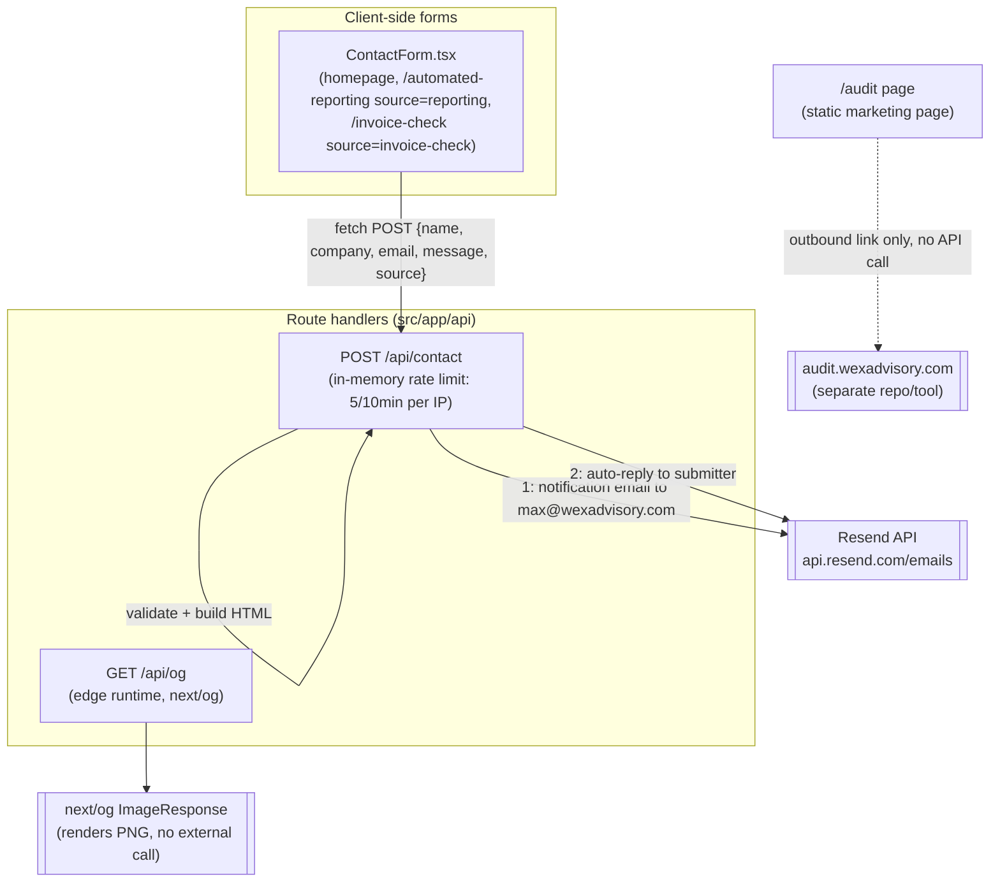

# Backend Architecture — wex-advisory (wexadvisory.com)

Generated by /architecture-map on 2026-08-18 — traced from code, not docs. Updated 2026-10-21: free-snapshot form and route removed (no page rendered the form); `src/lib/secret.ts` added.

This is the marketing/consulting site for Wex Advisory. It is almost entirely static
marketing pages (`src/app/*/page.tsx`). The only real backend surface is 2 Next.js
route handlers under `src/app/api/`. The only shared library code is `src/lib/secret.ts`
(`readSecret()`, strips a BOM and whitespace from env secrets). There is no cron config
(`vercel.json` does not exist in this repo) and no trigger.dev tasks.

## What's deliberately left out
- Page-level static routes (`/`, `/work`, `/privacy`, `/terms`, `/ai-*-for-small-businesses`) — no backend calls, pure marketing content.
- `scripts/generate-sample-report.js` and `scripts/redact-sample-report.js` — build-time/local scripts, not part of the runtime request path.

## Mismatches / notes found
- The `/audit` page markets "Free AI Opportunity Audit" but all it does is link out to `https://audit.wexadvisory.com/audit` — a separate, unrelated repo/tool (the actual AI Audit product). No audit logic lives in this codebase.
- No `vercel.json`, no cron jobs, no scheduled entry points exist in this repo — everything fires on-demand from a user request.
